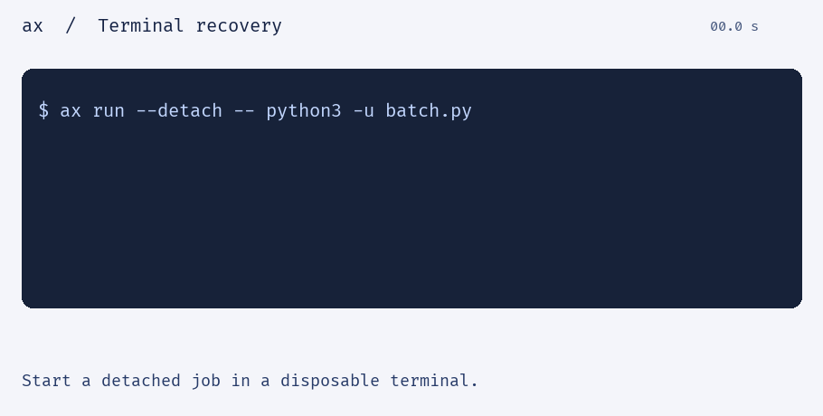

# Close the terminal. Keep the job.

This recording follows one real ax job. The launching shell exits, the native Mac panel opens its task menu, and Terminal reconnects to the same ID. The panel uses a synthetic conversation for this recording. The job, its output, the menu action, and the Terminal handoff are live.



## Try it in two terminals

Install ax from this repository and build the [Mac companion](https://github.com/EssenceSentry/ax-widget#build). In the first terminal, start a short job:

```sh
ax --caller codex:showcase run --detach -- python3 -u -c 'import time
for batch in range(1, 91):
    print(f"Batch {batch:02d} / 90", flush=True)
    time.sleep(1)'
```

Copy the returned ID and close that terminal. From the AX Widget checkout, replace `TASK_ID` below with the ID you copied:

```sh
swift run AXWidget --demo --expanded --demo-task TASK_ID
```

In **Terminal recovery demo**, open the job-count menu and choose **Reattach … in Terminal**. Earlier output appears first, followed by new batches. When you use ax from a real Claude or Codex session, its active launched jobs appear under the owning conversation. The ordinary terminal equivalent is `ax attach TASK_ID`. Commands registered only for progress reporting have no terminal stream.
